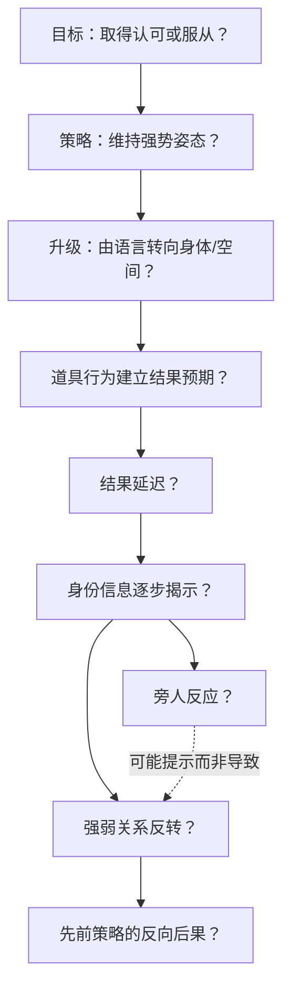

# 《功夫》点炮片段：第二层节拍精读准备

**状态：基于用户提供分析文本整理的待验证假说，不是已完成的真实视频精读。**

当前只读取到 supplied-notes.txt，没有读取到原始 MP4，未听音，也没有重跑切点检测。119.5 秒与约 23 个切点均来自该文本，未经本环境确认。下面时间均为文本中的约略片段相对位置，不是经核对的源 PTS、整片时间码或 SMPTE 标签。

## 从镜头目录转向可检验的因果解释

本轮的研究单位是“观众预期何时改变”，不是一个镜头对应一个笑点。
beat-candidates.json / CSV 归档 11 个候选：一个节拍可跨镜头，一个镜头也可包含多个节拍。区间可以重叠；Reveal、Reaction、Reversal 可以交织，不能为了套公式强行排成互斥时间段。

| 候选 | 文本约略位置 | 功能假说 | 优先复核 |
| --- | --- | --- | --- |
| B001 | 00:00–00:30 | Setup：建立个体与群体的对抗 | 人物目标、站位及群体态度有何直接证据 |
| B002 | 00:17–00:30 | Escalation：维持强势姿态 | 实际是否长镜头，动作与停顿如何连续发生 |
| B003 | 00:30–00:56 | Escalation：转为身体/空间动作 | 文本描述的动作是否出现，因果是否在同画面可见 |
| B004 | 约 00:56，结束未知 | Setup：道具信息插入 | 道具信息的可读性和确切镜头边界 |
| B005 | 00:58–01:09 | Delay：行为与结果分离 | 观众在等待哪一种结果，角色又知道什么 |
| B006 | 01:09–01:24 | Reveal：身份线索累积 | 首次足以识别身份的信息究竟在哪一帧 |
| B007 | 01:24–01:39 | Reversal：画面与关系变化 | 构图变化是否伴随可观察的行为权力变化 |
| B008 | 约 01:35 起，结束未知 | Reveal：信息与反应交替 | 真实镜头顺序，不能把文本列举当剪辑顺序 |
| B009 | 约 01:38，结束未知 | Reveal：局部身份线索 | 局部物件及其叙事功能 |
| B010 | 起止未知 | Reaction：旁人反应 | 反应由什么触发，先后顺序与延迟 |
| B011 | 起止未知 | Payoff：先前策略的反向后果 | 具体兑现行为与余波边界 |

JSON 保留文本行号与段落锚点；未提供的起止保持 null，源 PTS 全部保持 null，不按常见电影情节补齐。CSV 仅供浏览；JSON 是这些文本候选的完整记录。

## 喜剧因果链候选

以下箭头表示待检验关系，不表示已经确认的剧情事实或因果。

机器可读版本在 causality-candidates.json。每个节点关联候选节拍；视频证据字段留空。顺序相邻不等于因果成立，尤其不能把旁人的反应当作危险或反转的成因。

## 原文本需要降级或修正的结论

1. **“观众知道危险，角色不知道”尚不成立。** 看到道具行为不等于识别后来人物身份，更不等于知道结果。需分别标出观众、主角、旁人各自得到的信息及最早可识别时刻。
2. **长镜头不必然更好笑。** 实测镜头时长、信息可读性和反应时机，区分相关与因果；不同表演也可能需要切点。
3. **中心/近景不等于强势，远景/边缘不等于弱势。** 需结合视线、站位、动作主动权和他人响应；保留相反例子。
4. **Comic / Straight / Reaction 是段落中的功能，不是演员的固定分类。** 同一人物可以切换功能，多个功能也可由同一人承担。
5. **“身份比人物重要”“导演想让观众等待”属于分析解释。** 可观察事实应写镜头展示了什么、持续多久、随后切到什么；创作者意图不能直接判断。
6. **效果强弱未经观众实验验证。** 不将“这段证明了方向正确”“正式规则”作为验收结论。CR-01 至 CR-10 先当研究问题，不写入 Skill 的普遍规则。
7. **音轨未知。** 不推断静音、音乐停止、声音反转、对白内容或拟音位置；这些仍需实际听音。

## 原创对照实验：反应镜头的相对位置

这是独立原创实验设计，不是已由电影证据支持的方法卡。

场景：《幻想改造家》式虚构演示现场，设计师向体验员介绍一张“自动分配座位”的会议桌。桌面标签机把设计师标成“临时旁听”，把来送水的人标成“首席评审”。笑点来源是礼仪与系统标签之间的地位错位；不使用原片人物、街道、火药、帮派、身份标记或动作链。

- 控制：同一新场景、台词、表演、镜头素材、声音、总时长；两版本均使用同一 0.8 秒反应镜头。
- 变量：A 将反应镜头放在标签信息可读之后；B 将它放在标签信息展示之前。只交换同长镜头位置，不同时改变音量或台词。
- 测量：随机分组首次观看，记录信息理解正确率、笑意评分和笑点识别位置；先询问开放回答，避免提示预期答案。记录样本数量与不确定性。
- 可证伪条件：A 对理解和笑意没有稳定改善，或效果只取决于标签内容而非反应位置，则不支持“反应位置能放大兑现”的广泛结论。
- 替代解释：演员表情强度、标签可读性、观众对综艺套路的熟悉度；下一轮分别控制。

### 即梦／可灵原创导演指令（文字设计稿）

现代小型设计演示室，一张会议桌、桌面标签机、设计师、体验员与送水员，所有角色为原创成年人。写实生活喜剧，固定中全景先建立三人的位置和桌面关系。设计师认真介绍自动座位分配，不夸张挤眉弄眼。切近景清楚展示新打印的两张标签：“临时旁听”和“首席评审”，标签分别落在设计师和送水员的座位前。A 版在标签可读后切体验员 0.8 秒克制的停顿与目光转移；B 版将同一反应镜头移到标签展示前。随后回到共同中景，设计师试图保持礼貌，送水员仍只关心把水放稳。保持动作和视线连贯，保留自然环境声，不加笑声罐头。两个版本除镜头位置外保持一致；不借用现成电影角色、对白或标志性桥段。

精确文字标签和严格单变量剪辑可能超出一次模型生成的可靠控制范围；此指令仅是制作约束。正式实验应固定同一套素材再调整剪辑，不能把两次独立生成的差异归因于唯一变量。本轮不生成图片或视频。

## 取得原片后的执行与验收

原附件因下载工具 32 MiB 限制未能导入。请提供可下载链接、云端工作区路径，或较小副本；不要求本地安装工具。

如果真实时长确为 119.5 秒，现有 prepare_review.py 的 30–90 秒限制不能直接接收整段。可在云端选择两个重叠研究窗口并另存，明确记录原片 SHA、全片帧序号/PTS 和局部映射；重叠区只保留一份确认事件，不能双重计数。也可另行审查并扩展时长支持；本轮没有修改限制或声称已处理整段。

随后核对格式/音轨、生成代理、复核所有候选切点，并对 B002、B004–B010 的动作/表情/身份识别区段逐帧补取，不能只检查切点附近。逐镜头记录真实证据，再修订节拍起止和因果图。至少一张真实证据方法卡仍待原片，未用文本候选冒充。

本轮只做文本整理与文档/JSON一致性检查，不重新生成模拟电影，也不修改第一阶段 Skill、脚本或数据结构。
