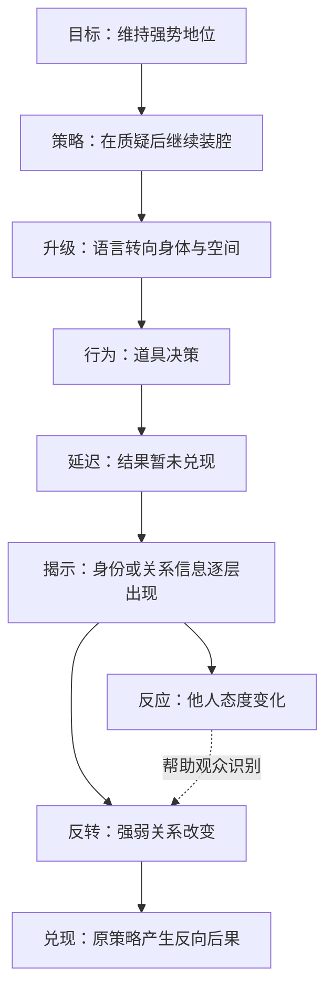

# 《功夫》点炮片段：喜剧导演研究成果整理

## 来源与成果状态

用户明确说明所提供文本就是原片段分析结果。本目录以该成果为研究来源进行结构化归档，不再将“重新上传视频”作为整理工作的前提。
原文保存在 source-analysis.txt，来源校验和与本环境执行状态保存在 provenance.json。

报告所记素材约119.5秒、机器初筛约23个视觉切点，均按用户提供结果引用。本环境未重新执行视频扫描、逐帧核对或听音；约略时间仍是约略时间，未知边界留空，不能换名为源 PTS。

本目录取代 ../kung-fu-dianpao-text-review/ 的来源定位：旧目录保留作为此前整理记录，新目录是本轮使用的成果入口。原有 Skill、预处理脚本、测试和第一阶段数据结构保持不变。

## 核心导演解释

根据用户原片分析，值得迁移的不是某个表情或台词，而是角色维持地位的策略如何不断提高代价，以及观众怎样通过道具、身份信息与反应镜头逐步修正判断。

工作模型为：**正常秩序与目标 → 错误策略 → 对抗升级 → 结果预期与延迟 → 信息揭示 → 反应与地位变化 → 后果兑现。**
这里的箭头是导演解释。旁人反应可能让观众读懂反转，不必是反转在剧情中的原因；地位变化也不只由人物占画面大小决定。

## 喜剧节拍时间轴

| 报告约略片段位置 | 节拍功能 | 导演研究重点 |
| --- | --- | --- |
| 00:00–00:30 | Setup | 个体与群体的关系及正常参照 |
| 00:17–00:30 | Escalation | 完整表演如何占用镜头时间 |
| 00:30–00:56 | Escalation | 空间调度与身体动作的可读性 |
| 约00:56，结束未提供 | Setup | 道具信息是否建立结果预期 |
| 00:58–01:09 | Delay | 行为与结果之间的等待 |
| 01:09–01:24 | Reveal | 线索如何逐步改变判断 |
| 01:24–01:39 | Reversal | 构图变化与人物关系变化 |
| 约01:35以后，结束未提供 | Reveal | 局部信息与反应交替 |
| 约01:38，结束未提供 | Reveal | 身份信息插入 |
| 原文未提供起止 | Reaction | 反应角色如何提示性质变化 |
| 原文未提供起止 | Payoff | 反向后果与余波的边界 |

表中存在重叠，反映原报告的层次而非错误地补齐分段。Reveal、Reaction、Reversal 不强制组成严格串行镜头。精确数据与段落出处见 beat-timeline.json，便于后续补充实测而不丢失原始来源。

## 喜剧因果链

图中内容是对用户分析的归纳，不包含本环境新增的电影事实。机器可读结构在 causality-graph.json；缺乏原文边界的节点不编造时间。

## CR-01～CR-10 方法库候选

每条均保存 Markdown 与 JSON，包含来源节拍、条件、操作、失败条件及对照变量。

| 编号 | 方法 | 使用限制 |
| --- | --- | --- |
| CR-01 | Straight Setup | 正常秩序要可理解，不要求摄影一定朴素 |
| CR-02 | Performance Hold | 保留完整表演链，不机械追求长镜头 |
| CR-03 | Reaction Amplifier | 反应必须提供信息，不是万能补镜头 |
| CR-04 | Comedy Delay | 延迟需有明确预期，不能只拖时长 |
| CR-05 | Escalation Chain | 升级要改变代价，动作变大不等于升级 |
| CR-06 | Status Framing | 构图辅助关系判断，不单独证明权力 |
| CR-07 | Comedy Spatial Integrity | 优先关系可读性，允许必要局部插入 |
| CR-08 | Information Insert | 插入需可辨认并改变当前判断 |
| CR-09 | Audience Knowledge Gap | 区分道具、身份、后果三类知识 |
| CR-10 | Serious Direction, Absurd Content | 克制与夸张都需服从情境，不设唯一风格 |

这些研究卡已有**用户原片分析报告**作为来源；可迁移效果仍为 hypothesis，没有虚构观众实验。由于第一阶段正式方法卡要求源视频 SHA、源 PTS 和真实 shot_id，本轮不拿文本 SHA 或节拍编号填充这些字段，也不改变该结构。报告级研究卡通过 method-index.json 单独索引，后续取得精确证据时再转为正式方法卡。

## 原创迁移与后续使用

ORIGINAL_EXPERIMENT.md 提供《幻想改造家》式原创演示场景的单变量对照实验，以及即梦/可灵文字导演指令；只迁移信息揭示与反应位置，不复制原片角色、台词、道具或动作链。

本轮完成的是：来源归档、11个节拍条目、因果模型、10张报告级研究卡及原创迁移方案。演员心理、创作意图、具体声画效果和笑点对观众的实际效力不能直接由这份报告证明；声音分析和精确镜头表没有补造。
